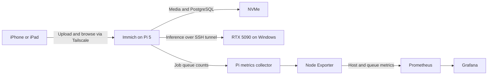

# NAiS

NAiS is a personal photo NAS. An iPhone backs up photos and videos to Immich on a Raspberry Pi 5. The Pi stores the library on a 1 TB NVMe SSD and generates thumbnails locally. A Windows PC with an RTX 5090 handles face detection and smart search. When the PC sleeps, phone uploads and timeline browsing continue.



| Workflow | Status | What works |
| --- | --- | --- |
| Personal Library | Deployed | Immich serves the phone library. The Pi handles metadata and thumbnails. The CUDA worker handles ML inference. |
| Monitoring | Deployed | The Grafana dashboard shows Pi health, Immich job queues, and worker reachability. |
| Independent backup | Pending | The next recovery milestone is restoring media and the database from a separate backup destination. |
| Camera Studio | Planned | The first milestone is fullscreen review of a Sony A7C RAW file on iPhone and iPad. Later milestones cover reversible edits, shared project looks, and explicit publication of finished exports to Immich mobile. |

## Run the Windows worker

The public Compose file targets an existing Immich v3.4.1 server. The setup guide covers the Windows container, the private connection from the Pi, and a check that an actual photo reaches CUDA. [Windows worker setup](infra/windows-ml/README.md) · [Compose file](infra/windows-ml/compose.yml)

## Check the storage filesystem

On the Pi, choose an existing writable directory on the SSD and check the device shown by `findmnt`. The example below assumes the user can write to the phone inbox. The script uses Python 3.11+ on Linux, writes a temporary 256 MiB file, flushes it, reads it back, and compares SHA-256 hashes. The JSON result includes the resolved test directory. Running without arguments uses `/var/tmp`. [Storage script](scripts/verify-storage.py)

```sh
target=/srv/nais/personal/incoming
findmnt -T "$target" -o SOURCE,TARGET,FSTYPE
python3 scripts/verify-storage.py --directory "$target"
```

The [Camera Studio roadmap](docs/camera-studio.md) describes the planned camera workflow and its acceptance checks.
